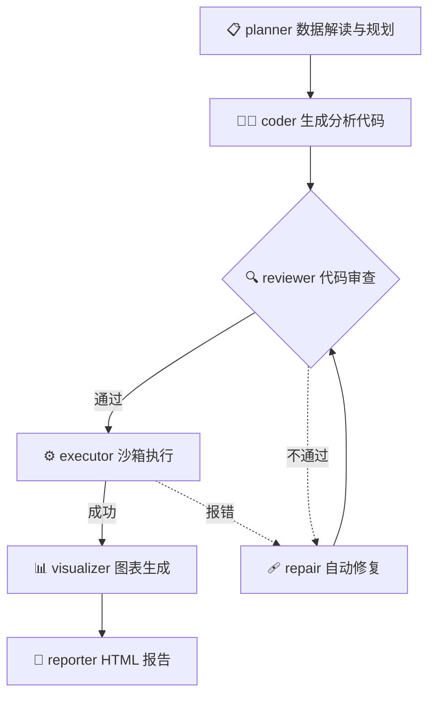

# 🤖 数据分析 Agent（Data Analysis Agent）


上传一份数据文件，用一句自然语言描述需求，Agent 会自动完成：**数据解读 → 代码生成 → 沙箱执行 → 报错自修复 → 图表与 HTML 报告输出** 的完整分析闭环。

## 🔄 工作流架构



> 执行报错时会把错误信息带回给模型重新生成，最多自动重试 3 次。

## ✨ 功能特性

- **自然语言数据分析**：基于 LangGraph 的多节点工作流（规划 → 生成 → 审查 → 执行 → 修复）
- **多格式支持**：CSV / XLSX / XLS / TSV / TXT / JSON / Parquet
- **安全沙箱**：AST 静态扫描拦截危险调用（`os.system`、`open` 敏感路径等）+ 30s 超时 + 256MB 内存限制
- **可视化输出**：matplotlib/seaborn 图表内嵌展示 + 可下载的 HTML 分析报告
- **历史会话**：侧边栏历史记录（时间分组 / 置顶 / 重命名 / 删除），豆包/DeepSeek 式交互
- **RAG 知识库**：内置 BGE-M3 + ChromaDB，检索数据分析方法论辅助代码生成

## 🛠️ 技术栈

| 层 | 技术 |
|---|---|
| 工作流编排 | LangGraph |
| 后端 API | FastAPI + Uvicorn |
| 前端界面 | Streamlit |
| 代码执行 | 受限子进程沙箱（AST 扫描 + 超时/内存限制） |
| RAG | ChromaDB + BAAI/bge-m3 |
| 数据处理 | pandas · numpy · matplotlib · seaborn |

## 🚀 快速开始（Docker Compose）

**1. 克隆并配置密钥** —— 在项目根目录创建 `.env`：

```ini
LLM_API_KEY=sk-xxx
LLM_BASE_URL=https://api.deepseek.com
LLM_MODEL_NAME=deepseek-v4-flash
```

**2. 一键启动：**

```bash
docker compose up --build -d
```

**3. 访问：**

- 前端界面：http://localhost:8501
- 后端接口文档：http://localhost:8001/docs

> 💡 首次做分析时会自动下载 BGE-M3 向量模型（约 2GB，国内网络默认走 hf-mirror 镜像），属正常现象。

<details>
<summary>不用 Docker？源码运行（点开）</summary>

```bash
# 创建虚拟环境（Python 3.11）
python -m venv langgraph_env
langgraph_env\Scripts\activate        # Windows
# source langgraph_env/bin/activate   # macOS / Linux

# 先装 CPU 版 torch（避免拉取 6GB 的 CUDA 版），再装项目依赖
pip install torch --index-url https://download.pytorch.org/whl/cpu
pip install -r requirements.txt
```

配好 `.env` 后开两个终端分别启动：

```bash
uvicorn api:app --host 0.0.0.0 --port 8001        # 终端 1：后端
streamlit run frontend/app.py --server.port 8501  # 终端 2：前端
```

</details>

## ⚙️ 配置说明

所有配置通过环境变量（`.env`）注入，除 `LLM_API_KEY` 外均有默认值：

| 变量 | 必填 | 说明 |
|---|---|---|
| `LLM_API_KEY` | ✅ | DeepSeek 或其他 OpenAI 兼容平台的 API 密钥 |
| `LLM_BASE_URL` | 否 | 默认 `https://api.deepseek.com`，可换任意 OpenAI 兼容端点 |
| `LLM_MODEL_NAME` | 否 | 默认 `deepseek-v4-flash` |
| `EMBEDDING_MODEL_NAME` | 否 | RAG 向量模型，默认 `BAAI/bge-m3` |
| `SANDBOX_TIMEOUT` | 否 | 沙箱执行超时秒数，默认 30 |
| `SANDBOX_MAX_MEMORY_MB` | 否 | 沙箱内存上限，默认 256 |
| `MAX_RETRY` | 否 | 代码报错自动修复的最大重试次数，默认 3 |
| `HF_ENDPOINT` | 否 | 国内网络建议设为 `https://hf-mirror.com` 加速模型下载 |

## 📁 项目结构

```text
data_analysis_agent/
├── api.py                   # FastAPI 后端：/chat、文件上传、会话管理
├── main.py                  # LangGraph 工作流装配（build_graph）
├── config.py                # 环境变量配置
├── run_eval.py              # 一键跑评测（配合 evaluation/）
├── requirements.txt         # 依赖清单
├── Dockerfile               # 镜像构建（CPU 版 torch + 中文字体）
├── docker-compose.yml       # 双容器编排：backend 8001 / frontend 8501
├── .streamlit/config.toml   # 前端主题配色
├── agent_workflow.mmd       # 工作流 Mermaid 源文件
├── agents/
│   ├── graph.py             # 工作流拓扑
│   ├── state.py             # 全局状态（AgentState）定义
│   └── nodes/
│       ├── agent.py         # 自主 ReAct 模式节点
│       ├── planner.py       # 数据解读与分析规划
│       ├── coder.py         # 生成 pandas/matplotlib 分析代码
│       ├── reviewer.py      # 代码安全与正确性审查
│       ├── executor.py      # 调用沙箱执行
│       ├── repair.py        # 带报错信息自动修复重试
│       ├── visualizer.py    # 图表生成
│       └── reporter.py      # 汇总输出 HTML 报告
├── sandbox/executor.py      # 受限执行器：AST 危险调用拦截 + 超时/内存限制
├── retrieval/
│   ├── retrievalembeddings.py    # BGE-M3 文本向量化
│   └── retrievalvectorstore.py   # ChromaDB 知识库读写
├── frontend/app.py          # Streamlit 聊天界面（历史会话 / 多格式上传）
├── evaluation/
│   ├── dataset.py           # 评测用例集
│   └── metrics.py           # 评测指标与执行器
├── tests/                   # 单元测试：test_agent / test_executor / test_sandbox
└── data/                    # 运行时数据：input / charts / reports（自动创建）
```

## 🙏 致谢

[LangGraph](https://github.com/langchain-ai/langgraph) · [Streamlit](https://streamlit.io/) · [BAAI/bge-m3](https://huggingface.co/BAAI/bge-m3)
